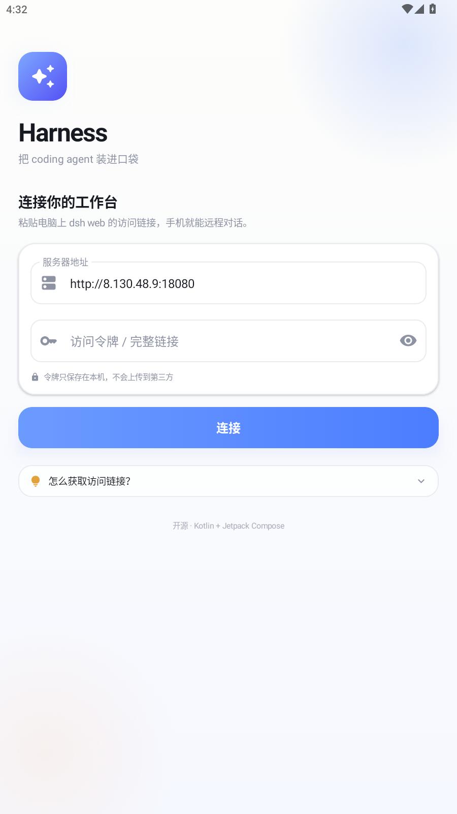
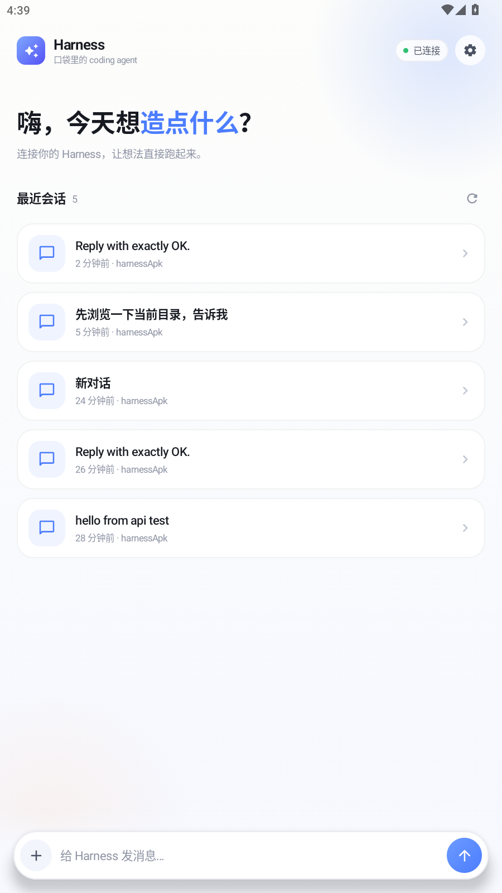
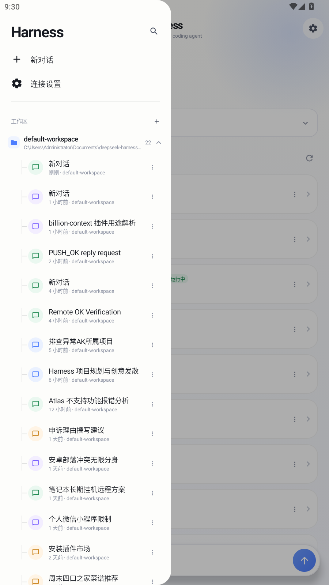
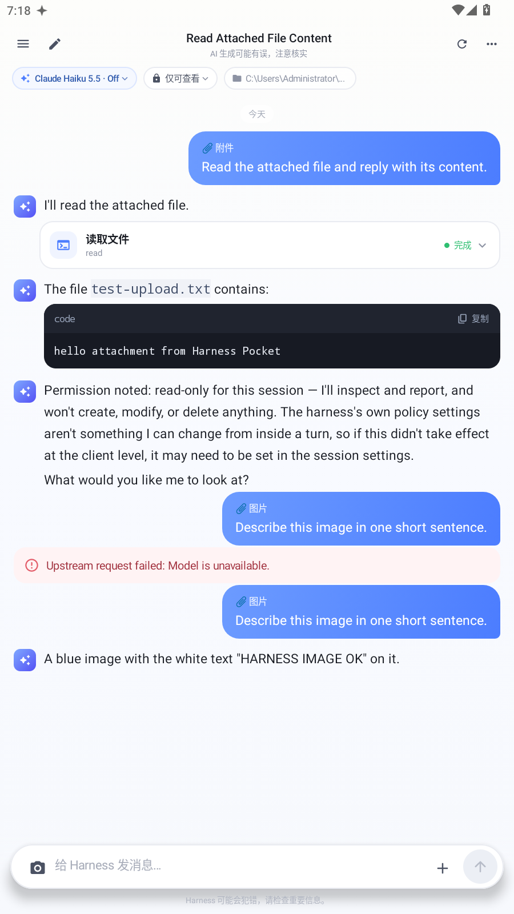
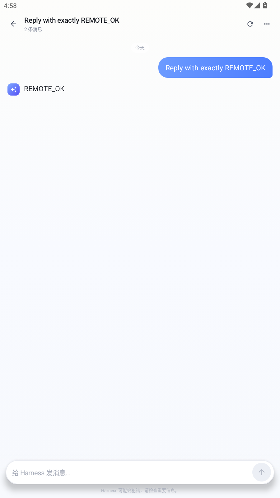
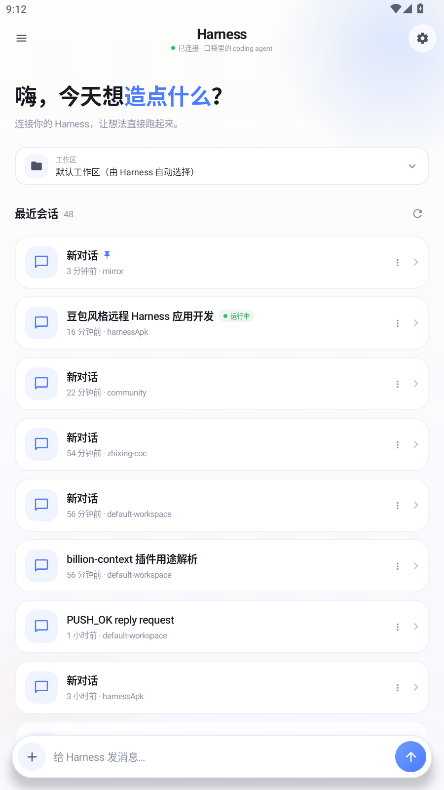
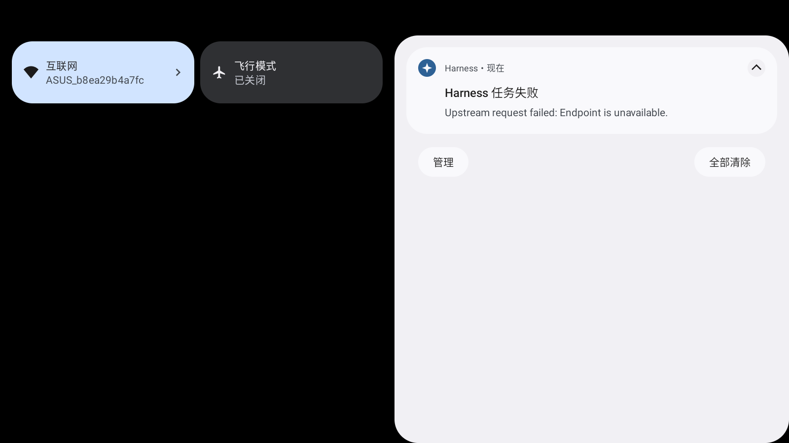
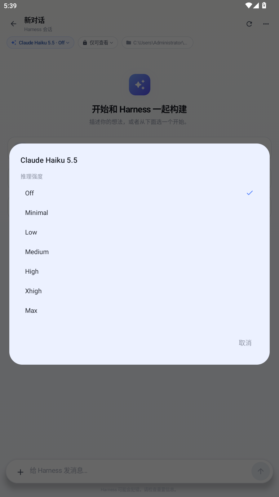
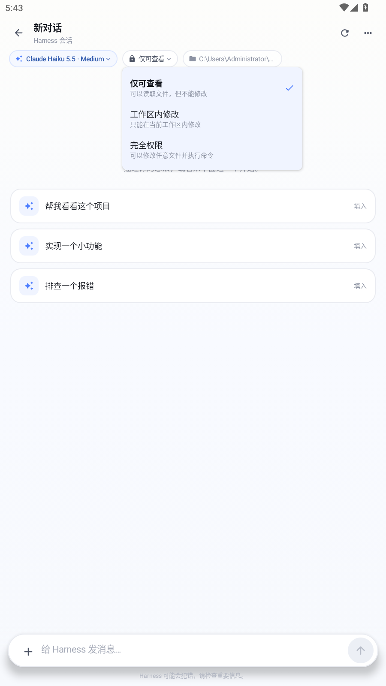
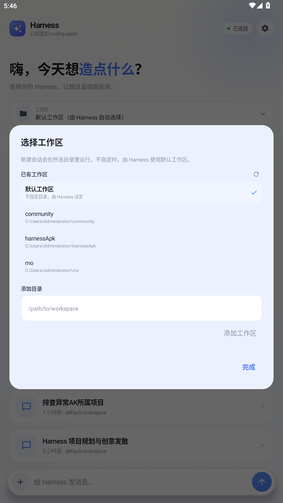

# Harness Pocket

把 DeepSeek Harness 装进口袋。一个原生 Android 客户端，通过 DSH 的 Remote API 连接你电脑上的 `dsh web`，在手机上继续和 coding agent 一起写代码。

界面参考豆包：暖白底色、蓝紫渐变、圆角卡片、蓝色用户气泡、无气泡的助手回复，以及可展开的工具调用卡片。0.4.0 起采用豆包式侧滑抽屉、居中标题和底部相机/输入/加号布局，抽屉内的会话按工作区分组为可折叠树，并支持置顶、归档和任务完成通知。

<p align="center">
  
  
  
  
</p>

## 功能

- **远程连接**：粘贴 `dsh web` 打印的完整访问链接（含 `?token=`），自动拆分服务器地址与令牌。
- **豆包式布局**：侧滑抽屉、居中标题、新建对话 / 连接设置；抽屉内按工作区分组展示会话树，可折叠、置顶和归档。
- **任务完成通知**：发送消息后启动前台轮询服务，检测到 `turn/end` 就在后台推送本地通知；点击通知回到对应会话。
- **会话列表**：按工作区分组查看会话、运行状态、工作目录和相对更新时间；支持置顶排序与归档/恢复。
- **继续对话**：打开历史会话，发送新消息，停止当前任务，重命名或刷新会话。
- **工作区选择**：通过 `workspace/follow` 读取工作区列表，新会话可以绑定到指定目录。
- **模型与推理强度**：从 `session/modelCatalog` 选择模型，再选择 Off / Minimal / Low / Medium / High / Xhigh / Max 等推理强度。
- **权限模式**：仅可查看、工作区内修改、完全权限；通过 `/permission <preset>` 命令真正写入会话策略。
- **附件**：图片直接内联为 base64，任意文件先走 `fileUploads/upload` 换 `receiptId`；单文件上限 20 MB。
- **工具调用可视化**：把 `tool/call`、`tool/result` 渲染成可展开卡片，参数和结果都能看。
- **Markdown**：标题、列表、引用、粗体、行内代码、代码块；代码块支持一键复制。
- **自动续期**：API Cookie 过期后，用本地保存的启动令牌自动重新 `/connect`。
- **无遥测**：不接入任何统计 SDK，令牌和会话只保存在本机。

## 实测

已在本机 MuMu 模拟器（Android 12L，900×1600）安装并跑通，包括通过公网连接 `dsh web` 实例、读取会话列表、打开历史会话、新建会话、发送消息和接收真实模型回复。



工具调用卡片、Markdown 代码块、停止任务、重命名与错误提示也都做了回归。

0.4.0 额外验证了：

- 抽屉“工作区”树：按 `cwd` 分组为 harnessApk、default-workspace、mirror、community、zhixing-coc 等节点，子会话缩进并画树线，节点可折叠。
- 置顶会话排在列表最前并显示图钉；归档后会话从主列表消失，底部“已归档”入口可查看并恢复。
- 已移除“会话主页”入口，工作区管理改为树标题右侧的 `+`。

<p align="center">
  
</p>

0.3.0 额外验证了：

- 豆包式抽屉：新对话 / 连接设置入口、背景任务通知。
- 对话页顶栏：左侧抽屉与新建，中间会话标题与“AI 生成可能有误”，右侧刷新与更多。
- 输入区：左侧相机、中间输入、右侧加号与发送/停止。
- 后台任务通知：把 App 切到后台后，收到“Harness 任务失败”通知；点击通知能回到对应会话。成功分支同样由 `turn/end` 触发，本次回归时上游模型返回了 403。
- 通知正文会从错误 JSON 中提取可读信息，不再直接展示整段错误对象。

<p align="center">
  
</p>

0.2.0 额外验证了：

- 选择 `harnessApk` 工作区并新建会话，`cwd` 正确落到该目录。
- 打开模型菜单选择 Claude Haiku 5.5，再选择推理强度 `Medium`；`session/list` 的 `modelSelection.next` 同步为 `claude-haiku-5-5 / medium`。
- 权限菜单选择“仅可查看”，`commands/execute` 返回 `preset read-only`，服务端 `permissions.currentValue` 同步变为 `read-only`。
- 附件选择 `test-upload.txt` 并发送；服务端读取附件内容后回复代码块。
- 选择 `test-image.png`，用支持视觉的 Claude Haiku 5.5 发送；模型正确识别图中的 “HARNESS IMAGE OK”。

<p align="center">
  
  
  
</p>

## 安装

### 直接安装 APK

已构建的 APK 在 `dist/HarnessPocket-0.4.0-debug.apk`；重新构建的产物在：

```text
app/build/outputs/apk/debug/app-debug.apk
```

连接手机或模拟器后：

```bash
adb install -r app/build/outputs/apk/debug/app-debug.apk
```

也可以把 APK 传到手机后直接安装。当前 APK 使用 debug 签名，适合自用和测试；正式分发请配置自己的 release keystore。

### 从源码构建

环境要求：

- JDK 11 或 17
- Android SDK Platform 33、Build-Tools 33.0.2
- 无需预装 Gradle，仓库自带 Gradle Wrapper 7.6.4

```bash
# Linux / macOS
export JAVA_HOME=/path/to/jdk
export ANDROID_HOME=/path/to/android-sdk
./gradlew assembleDebug
```

```powershell
# Windows PowerShell
$env:JAVA_HOME = "C:\Program Files\Java\jdk-11.0.12"
$env:ANDROID_HOME = "C:\path\to\android-sdk"
.\gradlew.bat assembleDebug
```

如果 SDK 不在默认位置，也可以新建 `local.properties`：

```properties
sdk.dir=C\:\\path\\to\\android-sdk
```

`settings.gradle.kts` 优先使用阿里云镜像，再回退到 Google / Maven Central；海外网络可以按需调整仓库顺序。

## 连接你的 Harness

1. 在电脑上启动 `dsh web`（或使用你已经在运行的实例）。启动日志会打印一条带启动令牌的链接，例如：

   ```text
   http://127.0.0.1:8080/?token=xxxxxxxx
   ```

2. 如果手机和电脑不在同一台机器，需要让 `dsh web` 监听局域网地址，或通过反向代理 / 内网穿透暴露端口。跨机访问时，记得把实际地址加入可信 Host，例如：

   ```bash
   dsh web --host 0.0.0.0 --port 18080 \
     --trusted-host 192.168.1.10:18080
   ```

   反向代理场景请保留原始 Host，并按 DSH 文档配置 `--trusted-host`。

3. 在 App 的连接页粘贴**完整链接**（推荐），或分别填写服务器地址与令牌。App 会请求：

   ```text
   GET {server}/connect?token={token}&interactions=none
   ```

   拿到 `dsh-auth-*` Cookie 后，所有 API 请求都会带上它。

4. 连接成功后即可看到会话列表。点开会话继续聊天，点底部的输入框新建会话。

> 令牌等同于登录凭证。不要把它发到公开群聊、截图或提交到 Git 仓库。

## 项目结构

```text
app/src/main/java/dev/harness/pocket/
├── MainActivity.kt          # 单 Activity + Compose 路由 + 抽屉 + 通知深链
├── MainViewModel.kt         # 连接、会话、轮询、发送、停止
├── TaskMonitorService.kt    # 前台任务轮询与完成通知
├── data/
│   ├── HarnessApi.kt        # /connect、/api RPC、Cookie 续期
│   ├── EventParser.kt       # DSH 事件 → UI 模型
│   ├── Models.kt            # Connection / Session / ChatItem
│   ├── ConnectionInput.kt   # 完整链接解析
│   ├── Prefs.kt             # 本地保存连接信息
│   └── Errors.kt
└── ui/
    ├── Theme.kt             # 豆包风配色与排版
    ├── ConnectScreen.kt     # 登录页
    ├── HomeScreen.kt        # 会话列表
    ├── ChatScreen.kt        # 对话页
    ├── Drawer.kt            # 豆包式侧滑抽屉
    ├── Components.kt        # 气泡、工具卡、输入框、设置
    ├── Markdown.kt          # 轻量 Markdown 解析与渲染
    └── Formatters.kt
```

协议细节见 [docs/PROTOCOL.md](docs/PROTOCOL.md)。

## 已知限制

- **轮询而非长连接**：当前通过 `session/list` + `session/page` 刷新，助手文本在消息落盘后出现，不是逐 token 打字机效果。后续会接入 `session/follow` WebSocket。
- **历史窗口**：每次最多取 80 条消息、24 条消息 / 4 个 turn 的窗口；很长的会话可能只显示最近部分。
- **审批交互**：以 `interactions=none` 连接，沙箱内自动放行的工具可以直接执行；需要人工审批的操作目前无法在 App 内点“同意”。请先在 Web 端处理审批，或把相应策略配置为自动允许。
- **图片需要视觉模型**：图片会直接内联发送；如果当前模型不支持图片，服务端会返回 `Model "..." does not support image input`，换用 Claude Haiku 5.5 等视觉模型即可，或先移除图片。
- **附件大小**：单个附件读取上限 20 MB；普通文件先上传换 `receiptId`，图片直接 base64 内联，超大图片会明显增加请求体。
- **权限切换依赖命令**：App 通过 `commands/execute` 执行 `/permission <preset>`；如果服务端禁用了命令或协议变化，权限菜单会显示错误而不会静默修改。
- **工作区列表依赖 WebSocket**：`workspace/follow` 断开时工作区选择器会显示加载失败，但已保存的会话仍可正常使用。
- **完成通知依赖前台服务**：任务运行期间 App 会启动 `dataSync` 前台服务，每 4 秒轮询一次 `session/list`；最长监控 20 分钟。系统省电策略、强制停止应用或关闭通知权限都会让提醒失效。没有接入 FCM，因此不是真正的远程推送。
- **通知内容**：通知只包含任务标题/错误摘要，不会展示完整回复；点击通知会打开对应会话。
- **明文 HTTP**：为了连接自建服务，Manifest 开启了 `usesCleartextTraffic`。公网使用请务必套 HTTPS 或 VPN。
- **令牌存储**：保存在应用私有的 `SharedPreferences`，未做额外加密；不要在已 root 的设备上使用敏感环境。
- **令牌轮换**：`dsh web` 重启或连接重载后，启动令牌可能变化。此时在 App 里重新粘贴新链接即可；自动续期只在旧令牌仍然有效时生效。

## Roadmap

- [ ] `session/follow` WebSocket，逐字流式输出
- [ ] 审批卡片（approval/asked / approval/decided）
- [x] 模型与推理强度选择
- [x] 图片、文件附件
- [x] 权限模式与工作区选择
- [x] 豆包式抽屉、顶栏与输入区
- [x] 任务完成本地通知
- [ ] 远程推送（FCM / ntfy 等），覆盖 App 进程被杀的场景
- [x] 会话置顶、归档、恢复
- [ ] 会话搜索、删除
- [ ] 深色模式与平板布局
- [ ] 可配置的 HTTPS / 证书校验

## 更新日志

### 0.4.0

- 抽屉“最近”改为工作区树：按 `cwd` 分组，工作区节点可折叠，子会话带缩进和树线。
- 新增会话置顶/取消置顶、归档/恢复；归档入口在会话列表底部。
- 移除“会话主页”入口，工作区管理移到“工作区”树标题旁的 `+`。
- 修复抽屉树中会话点击被整行点击拦截的问题。

### 0.3.0

- 豆包式侧滑抽屉：新对话、连接设置、置顶/最近会话。
- Home / Chat 顶栏改为居中标题；Chat 输入区改为相机 + 输入 + 加号。
- 新增 `TaskMonitorService`：后台轮询任务状态，完成/失败/停止时发本地通知，点击回到会话。
- 通知错误信息做可读化处理，不再直接展示整段 JSON。
- 新增通知渠道、Android 13 通知权限与通知图标。

### 0.2.0

- 模型目录与推理强度选择（`session/modelCatalog`、`session/selectModel`）。
- 权限模式切换（`permissionPresets/catalog` + `commands/execute` 的 `/permission`）。
- 工作区列表与新建会话绑定（`workspace/follow`）。
- 图片内联与任意文件上传（`fileUploads/upload`）。
- 修复输入框点击不聚焦、键盘不弹出的问题。
- 新增 `docs/PROTOCOL.md` 中的新端点说明。

### 0.1.0

- 首个可运行版本：连接、会话列表、历史消息、发送、停止、重命名、工具卡与 Markdown。

## 安全说明

- App 只与你填写的服务器通信，没有第三方接口、统计或崩溃上报。
- 启动令牌只用于换取 API Cookie；Cookie 与令牌都保存在应用私有目录。
- `/connect` 使用 `interactions=none`，不会在后台替你批准任何操作。
- 这是一个第三方客户端，不是 DeepSeek 官方产品；DSH 升级后协议可能变化。

## License

[MIT](LICENSE)
