# Harness Pocket

<p align="center">
  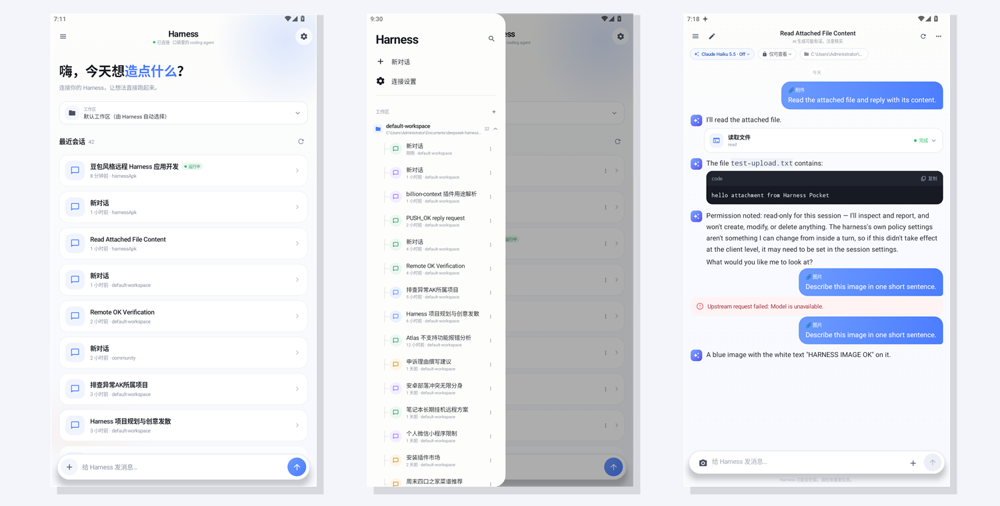
</p>

<p align="center">
  <b>在手机上远程使用你的 DeepSeek Harness coding agent。</b><br/>
  原生 Android 客户端 · Kotlin + Jetpack Compose · 非官方开源项目
</p>

## 这个项目是做什么的

Harness Pocket 是一个**非官方的原生 Android 客户端**，用来远程连接你电脑上运行的 DeepSeek Harness（DSH）`dsh web` 实例。

它解决的是一个很具体的问题：DSH 的网页版在手机上虽然能打开，但会话列表、工具调用、输入框和权限设置都按桌面布局设计，手机上操作起来很别扭。Harness Pocket 通过 DSH 的 Remote API，把同一套会话和 agent 能力搬到手机上：

- 连接同一个 `dsh web`，看到同一批会话
- 继续历史对话、发送新任务、停止运行中的任务
- 查看工具调用、参数、结果，以及 Markdown / 代码块
- 切换模型、推理强度、权限模式和工作区
- 任务结束时在手机上收到本地通知，点击通知回到对应会话

它不是 AI 模型服务，不提供 API key，也不替代 DSH 本体；它只是 DSH 的移动端遥控器。

## 它不是什么

- **不是 DeepSeek 官方产品**：这是一个第三方开源客户端，DSH 升级后协议可能变化。
- **不是 WebView 套壳**：界面用 Kotlin + Jetpack Compose 原生实现，不是把网页塞进浏览器控件。
- **不是云端服务**：没有中转服务器、统计 SDK 或账号系统；App 直接连接你填写的 `dsh web`。
- **不保存你的模型密钥**：模型调用仍由电脑上的 DSH 完成，App 只持有访问 DSH 的启动令牌 / Cookie。

## 效果图

<table>
  <tr>
    <td width="50%"><br/><sub><b>主页</b>：连接状态、工作区与最近会话</sub></td>
    <td width="50%"><br/><sub><b>工作区树</b>：默认折叠，标题显示运行中会话数</sub></td>
  </tr>
  <tr>
    <td width="50%"><br/><sub><b>对话页</b>：豆包式布局，支持 Markdown 与停止任务</sub></td>
    <td width="50%">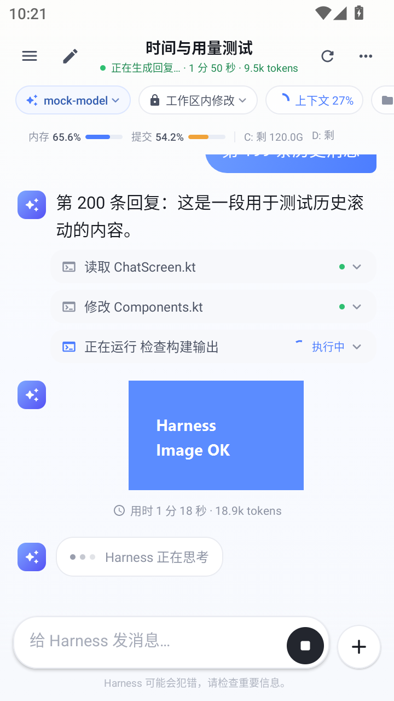<br/><sub><b>工具调用</b>：默认一行摘要，点开看参数和结果</sub></td>
  </tr>
  <tr>
    <td width="50%"><br/><sub><b>模型</b>：按 provider 分组，支持推理强度</sub></td>
    <td width="50%"><br/><sub><b>权限</b>：仅可查看 / 工作区内修改 / 完全权限</sub></td>
  </tr>
  <tr>
    <td width="50%">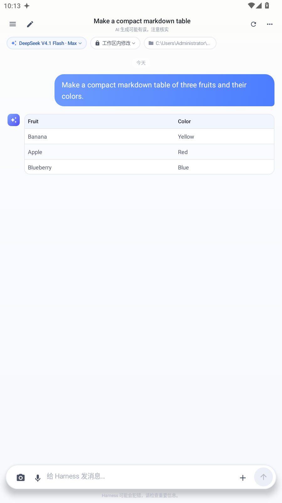<br/><sub><b>富文本</b>：表格、有序列表、代码块按块渲染</sub></td>
    <td width="50%">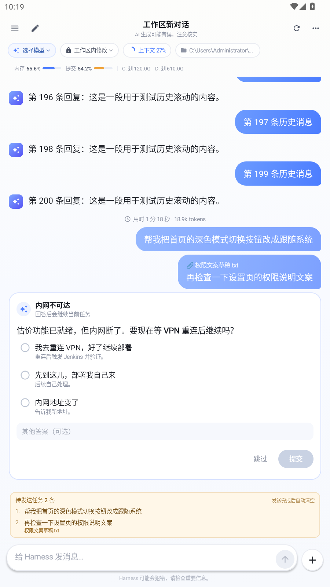<br/><sub><b>输入栏</b>：白色胶囊、加号面板与全屏编辑</sub></td>
  </tr>
  <tr>
    <td colspan="2" align="center">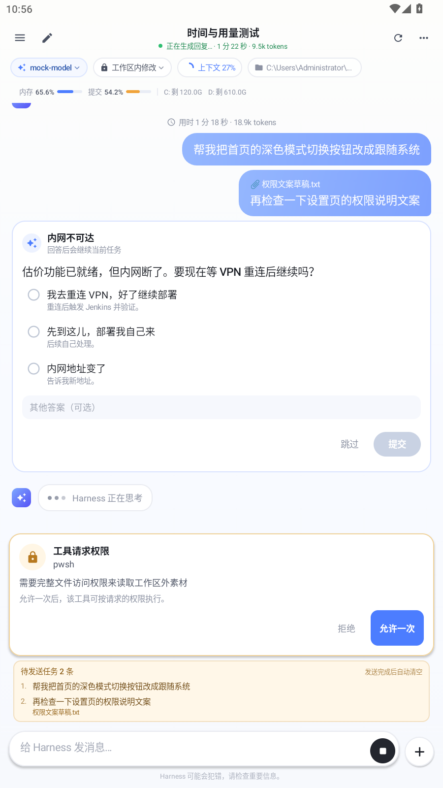<br/><sub><b>工具审批</b>：危险操作先确认，允许一次或拒绝</sub></td>
  </tr>
  <tr>
    <td colspan="2" align="center">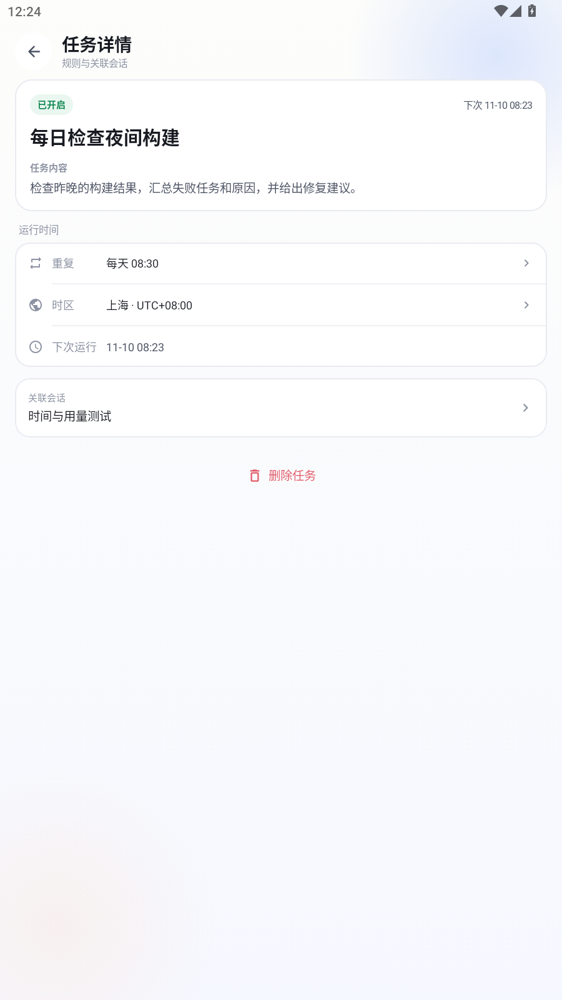<br/><sub><b>自动化任务</b>：查看详情、修改重复/时区、右滑删除</sub></td>
  </tr>
</table>

## 功能

- **远程连接**：粘贴 `dsh web` 打印的完整访问链接（含 `?token=`），自动拆分服务器地址与令牌。
- **豆包式布局**：侧滑抽屉、居中标题、新建对话 / 连接设置；抽屉内按工作区分组展示会话树，默认折叠，工作区标题显示运行中会话数，支持置顶和归档。
- **任务完成通知**：发送消息后启动前台轮询服务，检测到 `turn/end` 就在后台推送本地通知；点击通知回到对应会话。
- **会话列表**：打开会话自动落到最新消息；按工作区分组查看会话、运行状态、工作目录和相对更新时间；每行额外显示最近一条用户提问的单行预览；支持置顶排序与归档/恢复。
- **继续对话**：打开历史会话，发送新消息，停止当前任务，重命名或刷新会话；重开会话时从服务端 `inbox` 恢复待发送队列，不再因本地状态清空而丢失。
- **上下文占比**：对话页模型/权限胶囊旁显示“上下文 27%”胶囊和进度环；点击可查看已用 Tokens / 上下文窗口 Tokens。
- **工作区选择与排序**：通过 `workspace/follow` 读取工作区列表，新会话可以绑定到指定目录；文件夹按服务端顺序展示，标题右侧的拖动按钮支持上移/下移，顺序会写回服务端并与网页端同步；工作区标题右侧的加号可直接在该目录下新建对话。
- **模型与推理强度**：从 `session/modelCatalog` 选择模型，再选择 Off / Minimal / Low / Medium / High / Xhigh / Max 等推理强度。
- **权限模式**：仅可查看、工作区内修改、完全权限；通过 `/permission <preset>` 命令真正写入会话策略。
- **AI 控制电脑**：对话输入区新增开关，一键开启/关闭宿主 `dsh-windows-mcp` 的桌面工具控制权；与网页端共享同一 Host 全局状态，开启后显示“AI 控制中”，插件未安装或 Cookie 失效时明确提示。
- **微信式输入栏**：白色胶囊输入框、右侧加号；相机/相册/文件收进加号面板；相册使用自绘四列九宫格，最多 9 张。
- **全屏编辑与草稿**：输入超过 80 字或 3 行显示全屏按钮；全屏可查看附件缩略图并编辑发送；草稿文字和附件按会话保存，切换页面或重开会话后恢复。
- **附件**：支持一次多选图片/文件；图片直接内联为 base64，任意文件先走 `fileUploads/upload` 换 `receiptId`；单文件上限 20 MB。
- **可选中复制**：对话正文、用户气泡、工具结果和错误提示都支持长按选中，调用系统文本选择工具栏复制。
- **资源与并发**：读取 `dsh-conversation-queue` 插件的 `/dsh-resource/status`，展示内存、提交内存、磁盘占用和并发闸门的运行/等待数量；可直接把最大并发调到 1–8。未安装插件时显示明确提示。
- **自动化任务**：抽屉新增入口，读取 `schedule/catalog` 展示全部已开启/未运行任务；点开可看完整指令、规则和关联会话，修改每天/每周/间隔重复或时区；右滑任务可删除，详情也可进入原会话。
- **工具调用一行摘要**：把 `tool/call`、`tool/result` 收成网页端式单行，动态显示“读取 ChatScreen.kt / 修改 Components.kt / 运行 <命令>”等摘要；运行中显示转圈、失败标红，需要时点开看完整参数和结果。
- **更早历史只看对话**：点击“加载更早消息”后，旧历史中的工具调用卡（读取文件、修改文件等）自动隐藏，只保留你发送的内容和助手结果；最近一页的工具卡仍完整显示。
- **Markdown 与富文本**：标题、有序/无序/嵌套列表、引用、粗体、行内代码、代码块和表格；表格按列宽铺排，代码块支持一键复制；本地绝对路径图片通过 DSH 的 `/api/file` 路由加载。
- **交互问题卡**：`ask_user_question` 会显示成可选项、可补充文字的问题卡，而不是一坨 JSON；回答通过 `$events/result` 送回正在等待的任务，卡片随即收起。问题在 App 未打开会话时到达，也会在进入对应会话后补上。
- **工具审批**：危险工具请求会在对话页显示“工具请求权限”卡片，展示工具名和原因，可直接“允许一次”或“拒绝”；旧版本保存的连接会在启动时自动升级为可接收审批事件的 Cookie。
- **自动续期**：API Cookie 过期后，用本地保存的启动令牌自动重新 `/connect`。
- **无遥测**：不接入任何统计 SDK，令牌和会话只保存在本机。

## 它怎么工作

```text
┌──────────────────────────────────┐
│ 手机 App：Kotlin + Compose        │
│ 会话 / 工具卡 / 模型 / 权限 / 通知 │
└───────────────┬──────────────────┘
                │ 1. GET /connect?token=... → 签名 Cookie
                │ 2. POST /api/session/* → Remote RPC
                │ 3. WS /api/remote.mux → workspace/follow + $events
                ▼
┌──────────────────────────────────┐
│ 电脑上的 dsh web                  │
│ 会话、coding agent、工具、工作区   │
└──────────────────────────────────┘
```

- 令牌只用于换取一个绑定当前域名的签名 Cookie；后续 HTTP 与 WebSocket 都带这个 Cookie。
- App 不直接调用模型 API，模型调用、工具执行、工作区读写都发生在你的电脑上。
- 没有云端中转：你在连接页填哪个地址，App 就只连哪个地址。
- 这个仓库开源的是 Android 客户端本身，不包含 DSH 服务端，也不包含任何模型密钥。

**适合谁**：已经在电脑上使用 DSH，想用手机查看/继续任务、接收完成提醒，或想基于这个客户端改 UI、加功能的开发者。

## 实测

已在本机 MuMu 模拟器（Android 12L，900×1600）安装并跑通，包括通过公网连接 `dsh web` 实例、读取会话列表、打开历史会话、新建会话、发送消息和接收真实模型回复。


工具调用卡片、Markdown 代码块、停止任务、重命名与错误提示也都做了回归。

0.10.1 移除了语音输入入口，设备没有语音服务时不再显示麦克风或相关弹窗；输入栏保留文字、附件、加号面板与全屏编辑。

0.19.1 修复了：

- 工具结果里的图片（例如 `read_image` 返回的 `qq_state.png`）在真实会话中仍可能只显示“图片加载失败”的问题。
- 解析工具结果文本中的 `<path>`，当附件接口不可用时回退到 `/api/file?path=` 读取宿主机图片；加载成功的图片仍可点击全屏查看和缩放。

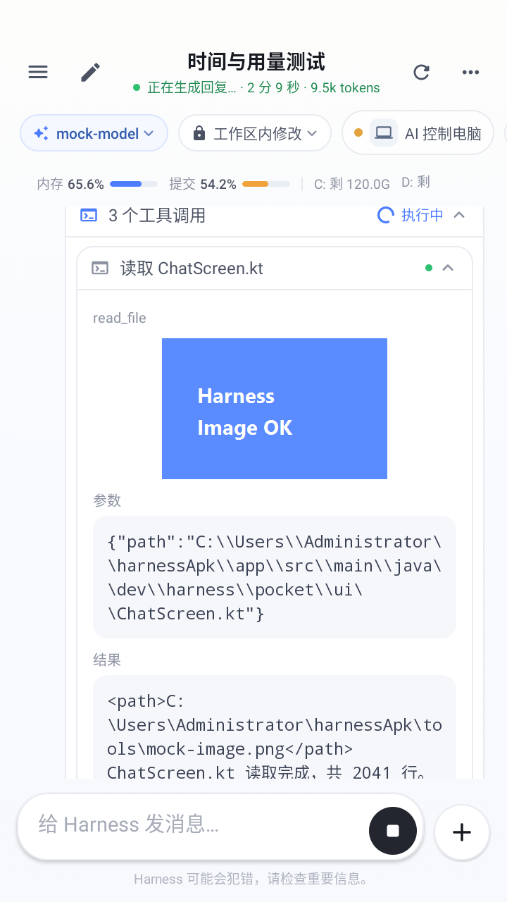

0.19.0 修复了：

- 助手消息里的 Markdown 本地图片（例如 ``）不再只显示成 `!二维码` 文本。
- 识别 DSH 网页端使用的 `api/file?path=...` 路由，使用当前连接 Cookie 读取宿主机绝对路径的图片；也兼容 `data:` 图片和同源/远程图片 URL。
- 二维码等图片按原图比例显示，点击可全屏查看、双指缩放和拖动。

0.18.0 新增了：

- 识别 DSH 的 `user-questions/request` 实时事件，把 `ask_user_question` 渲染成原生问题卡：标题、问题、选项、单选/多选、补充答案、跳过和提交。
- 回答不再依赖 `session/*` 投影；App 直接向 `$events/result` 回写 `eventId` 与结构化答案，正在等待的工具调用会继续执行。
- 问题在主页或别的会话中到达也会先暂存；进入对应会话后自动显示，不会因为先切走页面而丢失。
- 对应工具调用本身不再显示原始 JSON 参数。

<p align="center">
  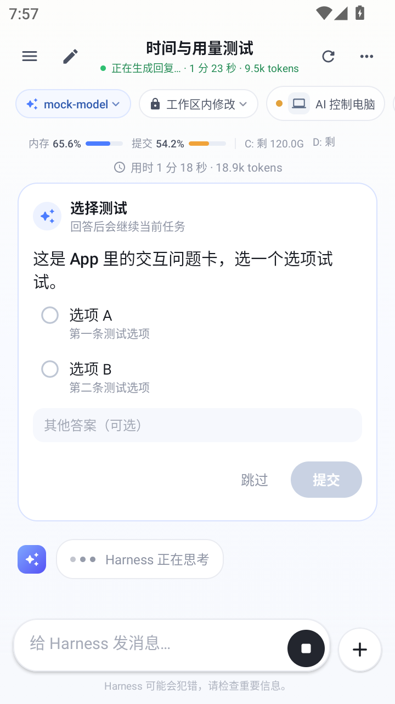
</p>

0.17.0 修复并验证了：

- 修复真实会话图片加载：DSH `session/attachment` 的 `data` 是字节数组而非 base64 字符串，旧版解析失败；现在按字节解码后再显示，工具结果里的图片也能加载。
- 连续工具调用不再逐条占一行，而是汇总为“3 个工具调用”这样一个紧凑区域；点开才看到每条工具摘要、参数和结果。
- 工具结果图片仍只在展开后出现，点击可全屏查看；图片加载失败时保留“轻触重试”。
- 已在 MuMu 上用与真实协议一致的 mock 附件（字节数组）验证助手图片、工具结果图片、全屏查看和工具汇总展开。

<p align="center">
  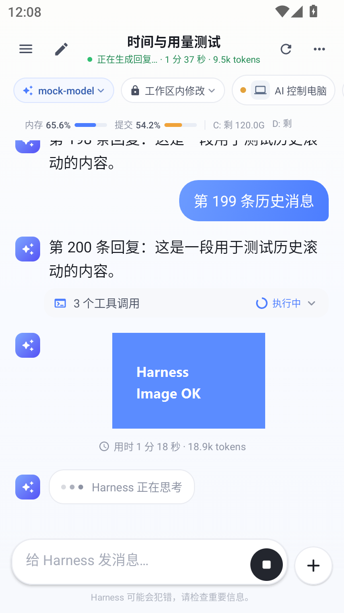
  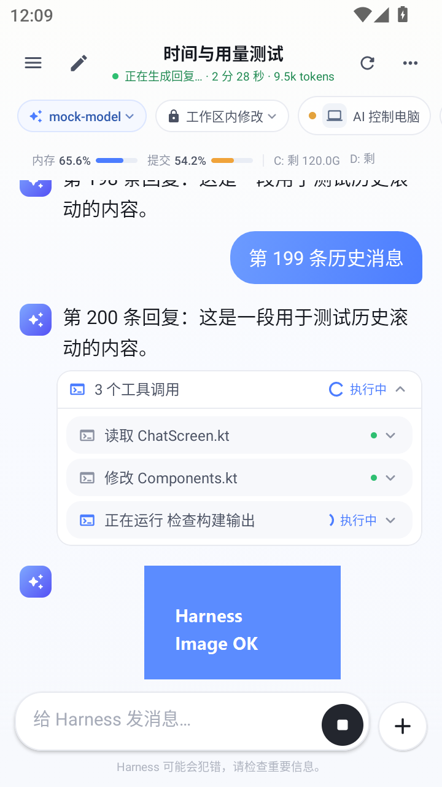
</p>

<p align="center">
  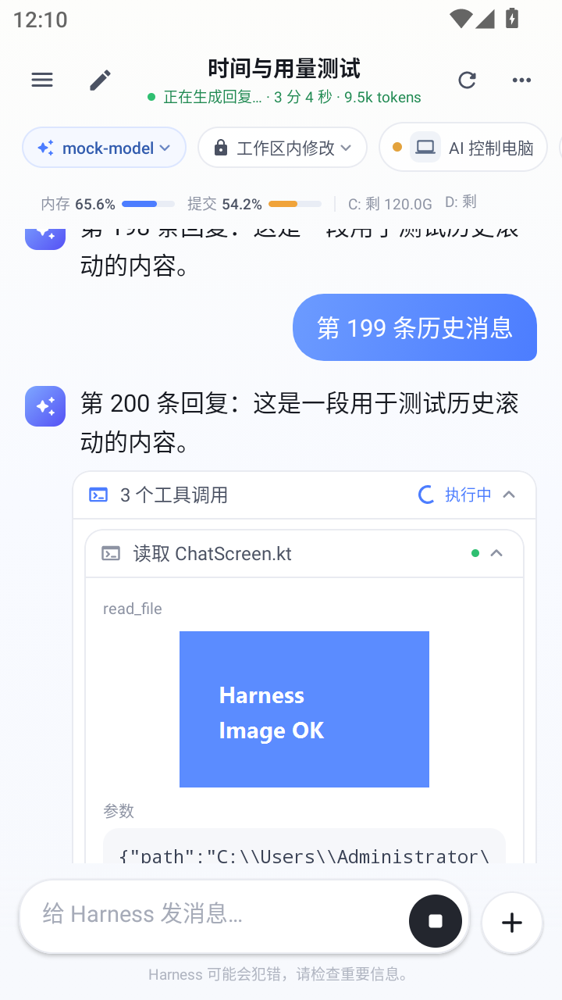
</p>

0.16.0 新增了：

- 对话输入区新增“AI 控制电脑”开关；点击即切换宿主 `dsh-windows-mcp` 的桌面工具控制权，与网页端共享同一全局状态。
- 开启时显示绿色“AI 控制中”，关闭时显示琥珀色“AI 控制电脑”；插件未安装、Cookie 不被接受或请求失败时显示“不可用/失败”提示，不会静默失败。
- 通过 `GET/POST /dsh-windows-mcp/state` 直接访问插件路由，不经过 `session/*` RPC；已验证开启、关闭和 App 重启后的状态同步。

<p align="center">
  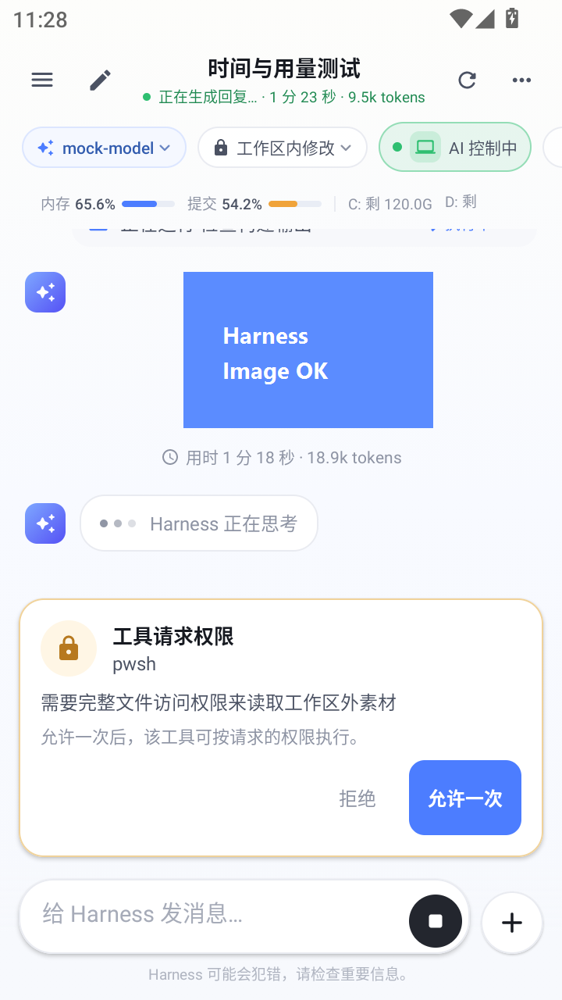
</p>

0.15.0 修复并验证了：

- 图片加载兼容 `data:image/...;base64,` 前缀、含换行的 base64 和 URL-safe base64；加载失败时显示“轻触重试”。
- 对话中的图片点击可全屏查看，支持双指缩放（1–5 倍）和拖动，右上角关闭。
- 工具卡收起时严格只显示一行，工具结果里的图片也只在展开后出现，避免占位撑开消息。

<p align="center">
  
  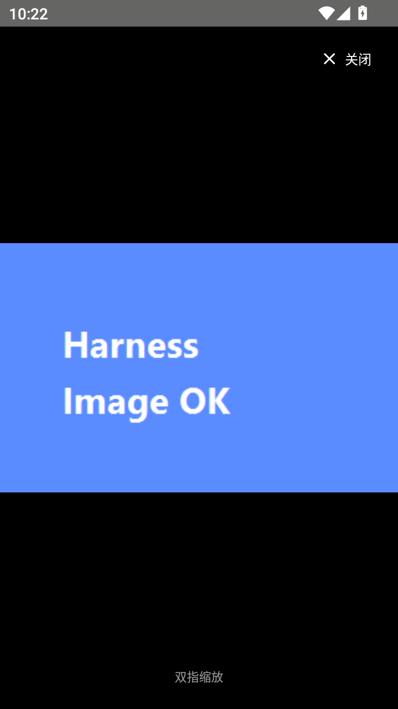
</p>

0.14.0 新增并验证了：

- 对话里的工具调用不再默认铺开完整参数；收起态是一行浅灰摘要，例如“读取 ChatScreen.kt”“修改 Components.kt”“运行构建命令”。
- 摘要按工具名和参数动态生成；命令优先用 description，文件和路径只显示文件名，运行中显示转圈和“执行中”，完成后是绿点，失败标红。
- 点这一行展开 `tool/call` 的完整参数与结果，再次点击收起；错误不再自动展开，避免打断阅读。

<p align="center">
  
  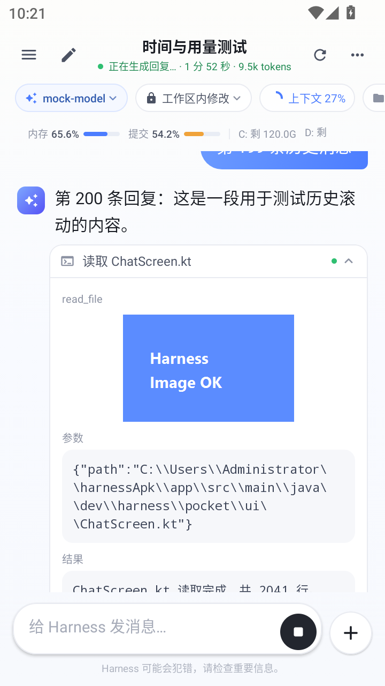
</p>

0.13.0 新增并验证了：

- 点开自动化任务可查看完整指令、状态、下次运行、重复规则、时区和关联会话。
- 点击“重复”可改成每天/每周/每小时/6/12/24 小时；点击“时区”可选系统、上海、东京、新加坡、伦敦、纽约或 UTC，选项带城市名和 UTC 偏移。
- 右滑任务卡或点详情底部“删除任务”会先弹出确认框，确认后调用 `schedule/delete`。
- 关联会话可直接打开；任务列表仍读取 `schedule/catalog`，创建任务继续在会话中通过提醒工具完成。

<p align="center">
  
  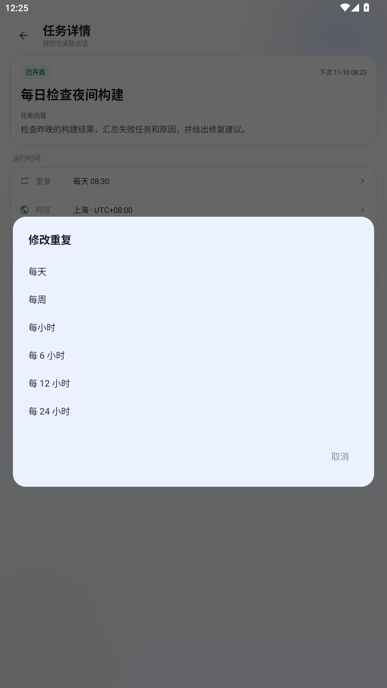
</p>

0.12.0 新增并验证了：

- 抽屉新增“自动化任务”入口，读取 `schedule/catalog` 展示所有会话的定时任务，包含已开启和未运行状态。
- 任务卡片显示标题、指令摘要、规则（每天/每周/间隔/Cron）、下次运行时间和原会话；0.12.0 时该页为只读展示。

<p align="center">
  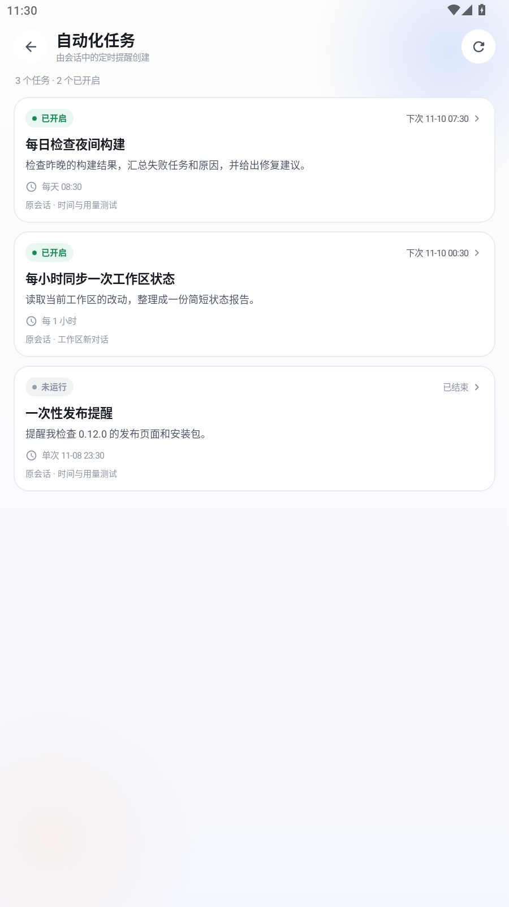
</p>

0.11.1 新增并验证了：

- 点击“加载更早消息”后，旧历史只保留用户消息和助手结果；读取文件、修改文件等工具卡不再显示，最近一页的工具卡不受影响。
- 修复了加载更早历史的边界：此前会把时间线起始项当成最小序号，导致分页停在原地。

<p align="center">
  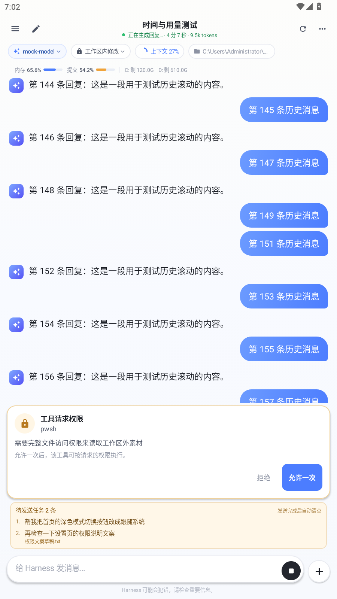
</p>

0.11.0 新增并验证了：

- 工具请求 `danger-full-access` 时，对话页底部弹出“工具请求权限”卡片，可选择“允许一次”或“拒绝”。
- 审批通过常驻的 `/api/remote.mux` `$events` 事件流接收，应答走 `$events/result`，不再需要回电脑处理。
- 连接握手改为 `interactions=answer`；升级安装后会静默用保存的令牌重新连接，旧版 `interactions=none` 的 Cookie 不会漏掉审批。

<p align="center">
  
  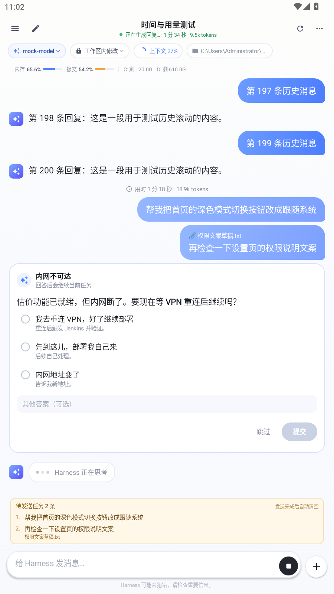
</p>

0.10.2 修复了相册/文件选择器返回的 MIME 与实际图片字节不一致、导致服务端报 `Declared image type does not match its bytes` 的问题：发送前按文件头识别真实格式；发送失败时保留已输入的草稿文字。

0.10.0 新增并验证了：

- 输入栏改为微信式：白色胶囊输入框、右侧加号；拍照、相册和文件统一收进加号面板。
- 自绘四列相册网格，支持最多 9 张多选，选中项显示蓝色边框和序号。
- 输入超过 80 字或 3 行出现全屏按钮；全屏编辑器显示附件缩略图、大输入框和发送按钮。
- 草稿文字和附件按会话保存，返回主页再打开会话后仍在。

<p align="center">
  
  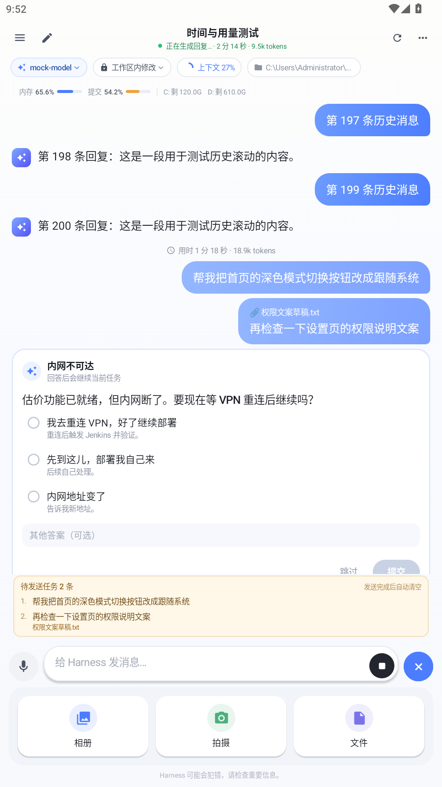
</p>
<p align="center">
  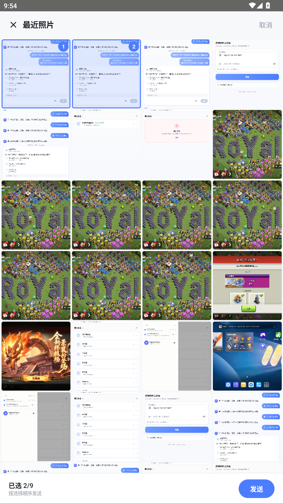
  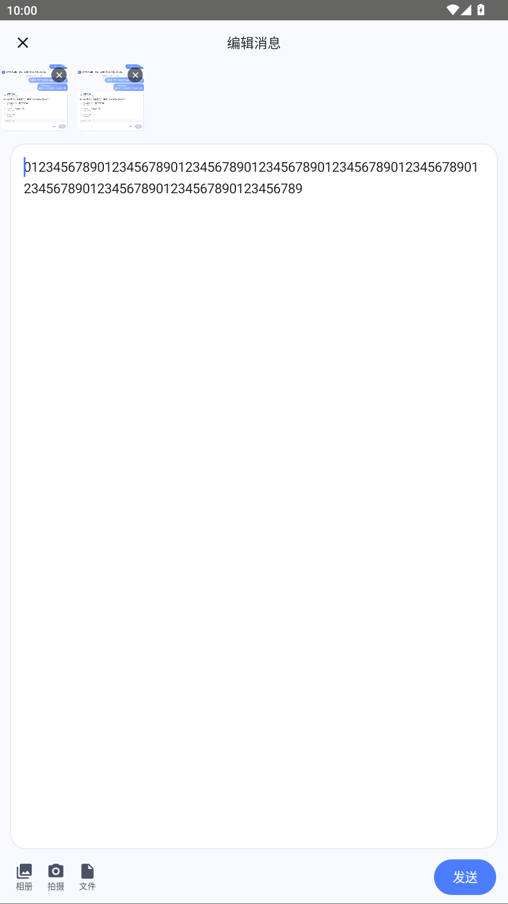
</p>
<p align="center">
  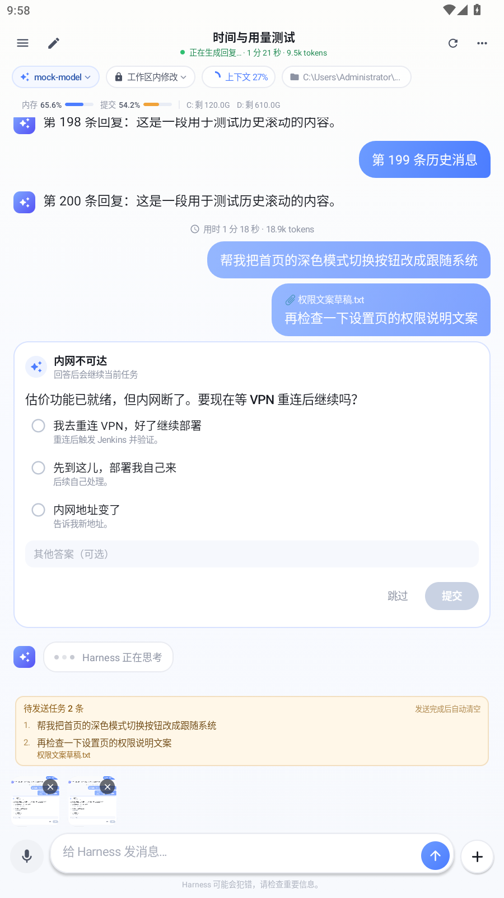
</p>

0.9.3 新增并验证了：

- 最近会话每一行显示该会话最近一条用户提问，单行预览、最长 120 字。
- 对话页控制栏显示上下文占用百分比；点击胶囊查看已用 Tokens 与上下文窗口。

<p align="center">
  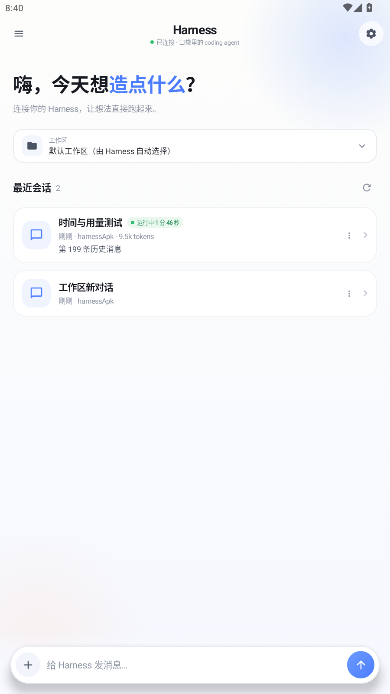
  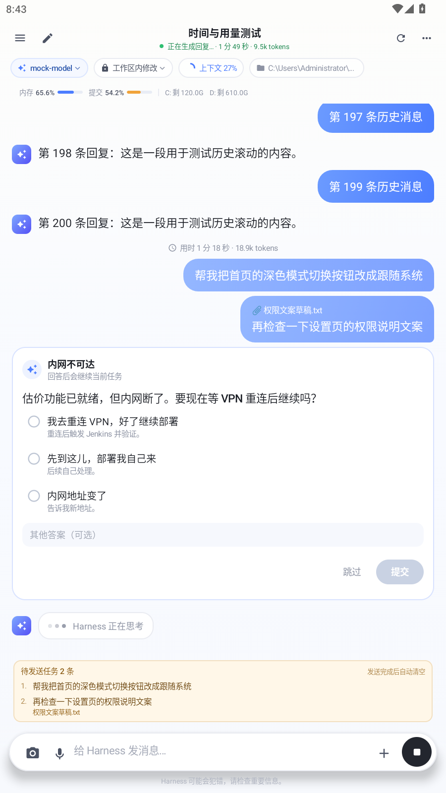
</p>

0.9.2 新增并验证了：

- 重开会话后从服务端 `inbox` 恢复待发送队列，关闭再打开不会丢失。
- 待发送队列逐条展示任务内容、附件名和剩余条数，而不只是“队列 N 条”。
- 工作区标题右侧新增加号，可直接在该工作区目录下新建对话。
- 修复 Android 11 包可见性导致误报“没有可用的语音识别服务”；不可用时提供“用键盘语音”按钮。

0.9.0 新增并验证了：

- 每轮对话结束显示本轮用时（如“用时 1 分 18 秒”）和本轮 Token 用量；运行中的会话在标题下方实时显示已运行时间。
- 会话列表的“运行中”徽标附带已运行时间；会话卡片显示累计 Token 用量。
- 语音按钮在设备没有系统语音识别服务时，会弹出说明，提示安装/启用语音服务或改用输入法麦克风，不再只有无反馈的 Toast。

0.8.4 新增并验证了：

- 附件支持一次多选：聊天输入框的加号/相机按钮使用 Android 多文档选择器，可一次选择多个文件或图片，逐个上传并显示为附件 chip。
- 工作区树的内容改为以 `workspace/follow` 的 `sessionIds` 为准，与网页端保持一致；不再把仅存在于 `session/list`、但不在任何工作区里的会话按 cwd 补进树里。

0.8.3 修复了问答卡不显示的问题：

- 打开会话时等待历史加载完成再滚到底部；此前首屏未到最新消息，位于末尾的问答卡会落在屏幕外。
- 除 `session/list` 投影外，打开会话时还会主动调用 `session/projections` 拉取 `userQuestions`；轮询不再用空投影清掉已显示的卡片。

0.8.2 修复了子代理会话打不开的问题：

- `session/list` 中 `origin=subagent` 的会话，打开时改用 `{kind:"subagent", parentSessionId, childSessionId, mode:"unknown"}` 作为 `session/page` 的 address，不再套用普通会话地址。

0.8.1 新增并验证了：

- 对话页在模型/权限胶囊下方增加一行资源摘要：内存占用、提交内存、各磁盘剩余空间；点这一行直接打开“资源与并发”页。
- 历史消息分页：首屏只取最近一段，滚到顶部显示“加载更早消息”，每次向前加载一页；轮询新消息时保留已经加载的旧页，不再被刷新覆盖。
- 任务运行中输入框的按钮会按状态切换：空输入显示停止；输入文字/附件后变为发送，发送后消息以“排队中…”显示，并在输入框上方显示队列数量。

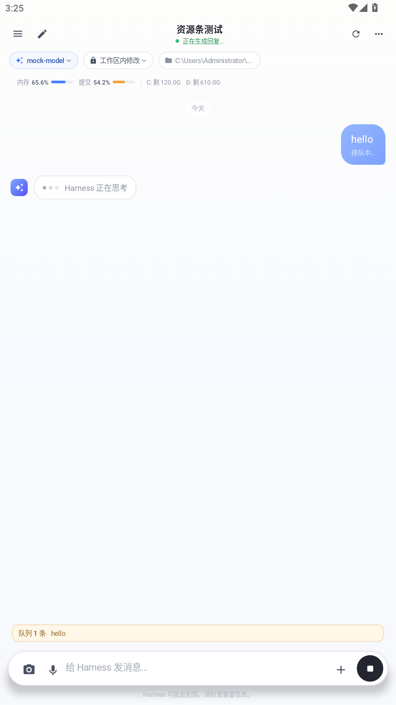

0.8.0 新增并验证了：

- 对话正文、用户气泡、工具结果和错误提示支持长按选中，并调起系统“复制”工具栏。
- 从 `dsh-conversation-queue` 插件的同源 `/dsh-resource/status` 读取内存/提交内存、磁盘和并发闸门状态，显示在独立资源页。
- 资源页可直接调并发上限：`POST /dsh-resource/limit`，范围 1–8，写回后立即刷新；未安装插件时显示“当前服务器未安装资源与并发插件”。

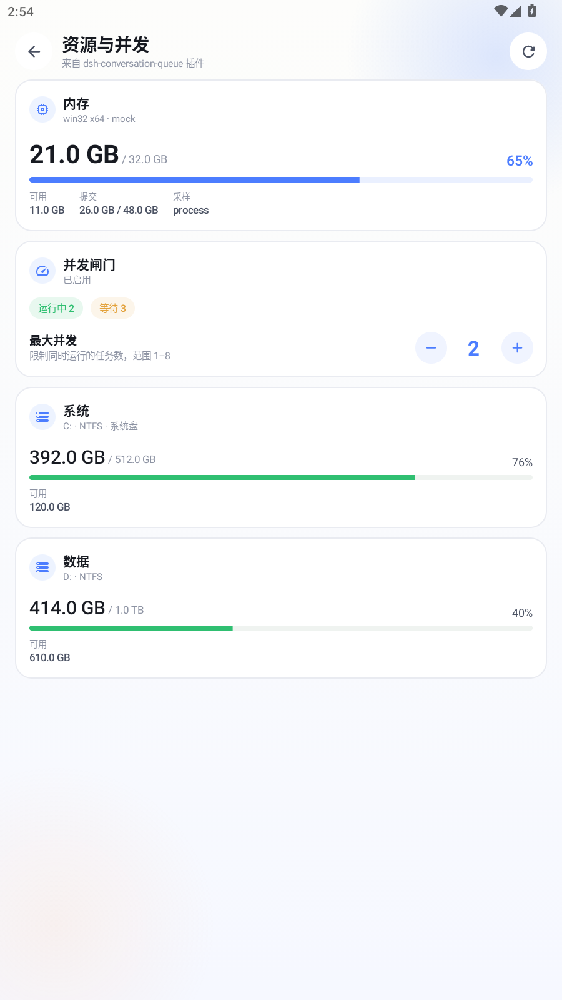

资源页在本地 mock 状态上验证了渲染和并发写回；连接已安装该插件的服务器时会显示真实数据。

0.7.1 新增并验证了：

- 对话内的图片不再只显示 `[图片]` 或附件名：用户消息、助手消息和工具结果中的 image block 会按 `attachmentId` 拉取 `session/attachment`，并以圆角图片卡直接显示。
- 发送图片后先显示本地预览，服务端回传后替换为会话内的真实附件；点发送时只携带已就绪的图片/文件，上传中的附件不会误发。
- 图片卡支持历史消息回看；图片字节按会话缓存，重复打开不会反复拉取。

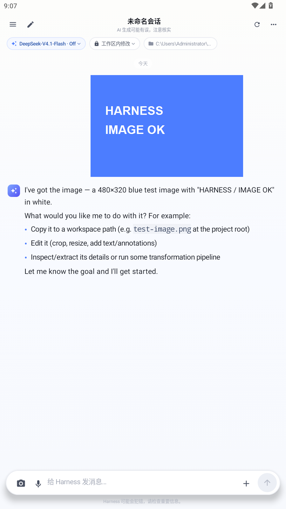

0.7.0 新增并验证了：

- 读取 `session/list` 的 `projections.values.userQuestions.active`，把 DSH 的 `ask_user_question` 调用渲染成可交互问答卡。
- 支持单选、多选、每题的“其他答案”输入，以及跳过/提交；提交调用 `userQuestions/answer`，按 question id 回传 selected/custom，成功后卡片自动收起。
- 用本机投影测试了多选和提交序列化；真实服务端需要问答调用进入 `continued` 状态（timed ask 返回 pending 后会进入该状态）。

0.6.0 额外验证了：

- 工作区文件夹顺序与 `workspace/follow` 的服务端顺序一致，不再按最近会话时间重排。
- 文件夹标题右侧新增拖动按钮，选择“上移/下移”后会调用 `workspace/insertBefore` 并写回服务端；重新打开网页端或 App 顺序一致。
- 空工作区也会像网页端一样显示，方便从文件夹直接发起新会话。

0.5.1 额外验证了：

- 打开长会话直接落在最新消息，不再从顶部慢慢滚到底部。
- 工作区树默认全部折叠；展开/收起状态仍可手动切换。
- 工作区标题右侧显示运行中徽标：`default-workspace`、`harnessApk` 各 1 个，`mirror` 2 个；数字随轮询自动更新。

0.5.0 额外验证了：

- 让模型输出三行水果表格，App 正确渲染成带表头、边框和隔行底色的表格（见 `docs/screenshots/chat-table.png`）。
- 麦克风按钮可拉起系统语音识别；当前 MuMu 模拟器没有识别 Activity，App 显示“当前设备没有可用的语音识别服务”。手机安装 Google/系统语音服务后即可使用。

0.4.0 额外验证了：

- 抽屉“工作区”树：按 `cwd` 分组为 harnessApk、default-workspace、mirror、community、zhixing-coc 等节点，子会话缩进并画树线，节点可折叠。
- 置顶会话排在列表最前并显示图钉；归档后会话从主列表消失，底部“已归档”入口可查看并恢复。
- 已移除“会话主页”入口，工作区管理改为树标题右侧的 `+`。

<p align="center">
  
</p>

0.3.0 额外验证了：

- 豆包式抽屉：新对话 / 连接设置入口、背景任务通知。
- 对话页顶栏：左侧抽屉与新建，中间会话标题与“AI 生成可能有误”，右侧刷新与更多。
- 输入区：左侧相机、中间输入、右侧加号与发送/停止。
- 后台任务通知：把 App 切到后台后，收到“Harness 任务失败”通知；点击通知能回到对应会话。成功分支同样由 `turn/end` 触发，本次回归时上游模型返回了 403。
- 通知正文会从错误 JSON 中提取可读信息，不再直接展示整段错误对象。

<p align="center">
  
</p>

0.2.0 额外验证了：

- 选择 `harnessApk` 工作区并新建会话，`cwd` 正确落到该目录。
- 打开模型菜单选择 Claude Haiku 5.5，再选择推理强度 `Medium`；`session/list` 的 `modelSelection.next` 同步为 `claude-haiku-5-5 / medium`。
- 权限菜单选择“仅可查看”，`commands/execute` 返回 `preset read-only`，服务端 `permissions.currentValue` 同步变为 `read-only`。
- 附件选择 `test-upload.txt` 并发送；服务端读取附件内容后回复代码块。
- 选择 `test-image.png`，用支持视觉的 Claude Haiku 5.5 发送；模型正确识别图中的 “HARNESS IMAGE OK”。

<p align="center">
  
  
  
</p>

## 安装

### 直接安装 APK

本地预构建的 APK 在 `dist/HarnessPocket-0.19.1-debug.apk`（二进制不提交到 Git 仓库）；从源码重新构建的产物在：

```text
app/build/outputs/apk/debug/app-debug.apk
```

连接手机或模拟器后：

```bash
adb install -r app/build/outputs/apk/debug/app-debug.apk
```

也可以把 APK 传到手机后直接安装。当前 APK 使用 debug 签名，适合自用和测试；正式分发请配置自己的 release keystore。

### 从源码构建

环境要求：

- JDK 11 或 17
- Android SDK Platform 33、Build-Tools 33.0.2
- 无需预装 Gradle，仓库自带 Gradle Wrapper 7.6.4

```bash
# Linux / macOS
export JAVA_HOME=/path/to/jdk
export ANDROID_HOME=/path/to/android-sdk
./gradlew assembleDebug
```

```powershell
# Windows PowerShell
$env:JAVA_HOME = "C:\Program Files\Java\jdk-11.0.12"
$env:ANDROID_HOME = "C:\path\to\android-sdk"
.\gradlew.bat assembleDebug
```

如果 SDK 不在默认位置，也可以新建 `local.properties`：

```properties
sdk.dir=C\:\\path\\to\\android-sdk
```

`settings.gradle.kts` 优先使用阿里云镜像，再回退到 Google / Maven Central；海外网络可以按需调整仓库顺序。

## 连接你的 Harness

1. 在电脑上启动 `dsh web`（或使用你已经在运行的实例）。启动日志会打印一条带启动令牌的链接，例如：

   ```text
   http://127.0.0.1:8080/?token=xxxxxxxx
   ```

2. 如果手机和电脑不在同一台机器，需要让 `dsh web` 监听局域网地址，或通过反向代理 / 内网穿透暴露端口。跨机访问时，记得把实际地址加入可信 Host，例如：

   ```bash
   dsh web --host 0.0.0.0 --port 18080 \
     --trusted-host 192.168.1.10:18080
   ```

   反向代理场景请保留原始 Host，并按 DSH 文档配置 `--trusted-host`。

3. 在 App 的连接页粘贴**完整链接**（推荐），或分别填写服务器地址与令牌。App 会请求：

   ```text
   GET {server}/connect?token={token}&interactions=none
   ```

   拿到 `dsh-auth-*` Cookie 后，所有 API 请求都会带上它。

4. 连接成功后即可看到会话列表。点开会话继续聊天，点底部的输入框新建会话。

> 令牌等同于登录凭证。不要把它发到公开群聊、截图或提交到 Git 仓库。

## 项目结构

```text
app/src/main/java/dev/harness/pocket/
├── MainActivity.kt          # 单 Activity + Compose 路由 + 抽屉 + 通知深链
├── MainViewModel.kt         # 连接、会话、轮询、发送、停止
├── TaskMonitorService.kt    # 前台任务轮询与完成通知
├── data/
│   ├── HarnessApi.kt        # /connect、/api RPC、Cookie 续期
│   ├── EventParser.kt       # DSH 事件 → UI 模型
│   ├── Models.kt            # Connection / Session / ChatItem
│   ├── ConnectionInput.kt   # 完整链接解析
│   ├── Prefs.kt             # 本地保存连接信息
│   └── Errors.kt
└── ui/
    ├── Theme.kt             # 豆包风配色与排版
    ├── ConnectScreen.kt     # 登录页
    ├── HomeScreen.kt        # 会话列表
    ├── ChatScreen.kt        # 对话页
    ├── Drawer.kt            # 豆包式侧滑抽屉
    ├── Components.kt        # 气泡、工具卡、输入框、设置
    ├── Markdown.kt          # 轻量 Markdown 解析与渲染
    └── Formatters.kt
```

协议细节见 [docs/PROTOCOL.md](docs/PROTOCOL.md)。

## 已知限制

- **轮询而非长连接**：当前通过 `session/list` + `session/page` 刷新，助手文本在消息落盘后出现，不是逐 token 打字机效果。后续会接入 `session/follow` WebSocket。
- **历史窗口**：每次最多取 80 条消息、24 条消息 / 4 个 turn 的窗口；很长的会话可能只显示最近部分。
- **审批交互**：需要人工审批的工具会在对话页显示“允许一次/拒绝”卡片；审批事件依赖 `interactions=answer` 与常驻 `$events` 连接，若服务器断开 WebSocket，卡片会在重连后继续出现。自动放行的工具仍直接执行。
- **图片需要视觉模型**：图片会直接内联发送；如果当前模型不支持图片，服务端会返回 `Model "..." does not support image input`，换用 Claude Haiku 5.5 等视觉模型即可，或先移除图片。
- **附件大小**：单个附件读取上限 20 MB；普通文件先上传换 `receiptId`，图片直接 base64 内联，超大图片会明显增加请求体。
- **权限切换依赖命令**：App 通过 `commands/execute` 执行 `/permission <preset>`；如果服务端禁用了命令或协议变化，权限菜单会显示错误而不会静默修改。
- **工作区列表依赖 WebSocket**：`workspace/follow` 断开时工作区选择器会显示加载失败，但已保存的会话仍可正常使用。
- **完成通知依赖前台服务**：任务运行期间 App 会启动 `dataSync` 前台服务，每 4 秒轮询一次 `session/list`；最长监控 20 分钟。系统省电策略、强制停止应用或关闭通知权限都会让提醒失效。没有接入 FCM，因此不是真正的远程推送。
- **通知内容**：通知只包含任务标题/错误摘要，不会展示完整回复；点击通知会打开对应会话。
- **明文 HTTP**：为了连接自建服务，Manifest 开启了 `usesCleartextTraffic`。公网使用请务必套 HTTPS 或 VPN。
- **令牌存储**：保存在应用私有的 `SharedPreferences`，未做额外加密；不要在已 root 的设备上使用敏感环境。
- **令牌轮换**：`dsh web` 重启或连接重载后，启动令牌可能变化。此时在 App 里重新粘贴新链接即可；自动续期只在旧令牌仍然有效时生效。

## Roadmap

- [ ] `session/follow` WebSocket，逐字流式输出
- [x] 审批卡片（工具权限允许一次 / 拒绝）
- [x] 模型与推理强度选择
- [x] 图片、文件附件
- [x] 权限模式与工作区选择
- [x] 豆包式抽屉、顶栏与输入区
- [x] 任务完成本地通知
- [ ] 远程推送（FCM / ntfy 等），覆盖 App 进程被杀的场景
- [x] 会话置顶、归档、恢复
- [x] 交互式问答卡（单选/多选/自定义）
- [ ] 会话搜索、删除
- [ ] 深色模式与平板布局
- [ ] 可配置的 HTTPS / 证书校验

## 更新日志

### 0.19.1

- 修复工具结果图片在真实会话中仍显示“图片加载失败”的问题：工具结果里的图片现在会解析结果文本中的 `<path>`，在附件接口不可用时回退到 DSH 的 `/api/file?path=` 路由读取绝对路径。
- 回退读取同样携带当前连接 Cookie，图片加载成功后支持点击全屏查看和缩放。

### 0.19.0

- 修复助手 Markdown 本地图片：`` 不再显示为 `!alt` 文本，改为通过 DSH 的 `/api/file?path=` 路由读取并渲染。
- 兼容 `data:` 图片和 HTTP(S) 图片 URL；本地路径请求携带当前连接 Cookie，点击图片可全屏查看和缩放。
- 使用与 DSH 网页端相同的 `/api/file` 路由；已用同协议 mock 验证 Markdown 本地图片渲染和全屏查看。

### 0.18.0

- 新增交互问题卡：识别 DSH `user-questions/request` 事件，把 `ask_user_question` 渲染成标题、问题、选项、补充答案和提交按钮，不再显示原始 JSON。
- 回答通过 `$events/result` 回写 `eventId` 与结构化答案；继续等待中的工具调用会恢复执行。
- 问题在主页或其他会话到达时先缓存，进入对应会话后自动显示。
- 对应工具调用不再生成普通工具卡，避免重复和参数噪音。

### 0.17.0

- 修复真实会话图片加载：`session/attachment` 返回的 `data` 是字节数组，改为字节解码后显示；工具结果里的图片恢复可用。
- 连续工具调用汇总为一行“N 个工具调用”，展开后查看每条工具摘要、参数和结果。
- 助手图片、工具结果图片、全屏查看器和失败重试均已回归。

### 0.16.0

- 对话输入区新增“AI 控制电脑”开关，直接控制宿主 `dsh-windows-mcp` 的桌面工具；与网页端共享 Host 全局状态。
- 开关支持开启/关闭、加载中、不可用和失败提示；当前状态显示为绿色“AI 控制中”或琥珀色“AI 控制电脑”。
- 新增 `GET/POST /dsh-windows-mcp/state` 接入，404 与 401 均有明确错误提示。

### 0.15.0

- 修复对话图片加载：兼容 data URI 前缀、换行和 URL-safe base64；失败时可轻触重试。
- 图片支持点击全屏查看，双指缩放 1–5 倍、拖动平移，右上角关闭。
- 工具卡收起态严格一行，工具结果图片移入展开区，不再在消息流中占位。

### 0.14.0

- 对话工具调用改为网页端式单行摘要：读取/修改文件、运行命令、搜索等按参数动态生成；运行时显示转圈和“执行中”，完成后显示绿点，失败标红。
- 点击摘要行展开完整工具名、参数 JSON 和结果，再点收起；错误不再自动展开。
- 工具摘要中的文件路径只显示文件名，避免长路径撑满一行。

### 0.13.0

- 自动化任务支持详情页：完整指令、状态、下次运行、重复规则、时区和关联会话。
- 支持修改重复（每天/每周/每小时/6/12/24 小时）和时区；时区选项显示城市名和 UTC 偏移。
- 支持右滑任务卡或详情页删除任务，删除前需确认；关联会话可直接打开。

### 0.12.0

- 新增“自动化任务”页：从抽屉进入，读取 `schedule/catalog` 展示全部已开启和未运行任务。
- 每个任务显示标题、指令摘要、时间规则、下次运行时间和原会话；点击可回到原会话。
- 0.12.0 的任务页为只读展示，创建/修改/删除在 0.13.0 加入。

### 0.11.1

- 加载更早消息后，旧历史中的工具调用卡（读取/修改文件等）自动隐藏，只保留用户消息和助手结果；最近一页的工具卡仍显示。
- 修复加载更早历史的边界计算：不把时间线起始项当成最小消息序号，分页可正常前进。

### 0.11.0

- 新增工具审批卡片：收到 `approval/request` 时显示工具名和原因，可“允许一次”或“拒绝”。
- 常驻 `/api/remote.mux` 的 `$events` 事件流接收审批请求，应答提交到 `$events/result`。
- 连接握手改为 `interactions=answer`；启动时静默刷新旧 Cookie，升级后无需重新连接即可收到审批。
- 审批卡片与队列、问答卡同时显示，不遮挡输入区。

### 0.10.2

- 发送图片前按文件头识别真实格式，不再直接信任相册/文件选择器返回的 MIME，修复 `Declared image type does not match its bytes`。
- 发送失败时保留已输入的草稿文字，并把错误标题区分为“发送失败”和“对话加载失败”。

### 0.10.1

- 移除语音输入入口、语音权限/可见性声明和不可用弹窗；输入栏只保留文字、附件和发送。
- 聊天输入栏宽度重新分配，去掉左侧麦克风后输入框获得更完整的横向空间。

### 0.10.0

- 输入栏改为微信式：白色胶囊输入框、右侧加号；拍照、相册和文件收进加号面板。
- 新增自绘四列相册网格，支持最多 9 张多选，选中项显示序号。
- 输入超过 80 字或 3 行显示全屏按钮；全屏编辑器支持附件缩略图、大输入框、发送和关闭。
- 草稿文字和附件按会话保存，切换页面或重开会话后恢复。
- 新增 `FileProvider` 全分辨率拍照、媒体读取权限和相册选择器。

### 0.9.3

- 最近会话卡片增加最近一条用户提问的单行预览；通过 `session/page` 提取，空白会话跳过，最多 120 字。
- 对话控制栏增加上下文占用胶囊，显示百分比和进度环；点击查看已用 / 窗口 Tokens。
- 上下文数据来自 `session/projections` 的 `contextPressure`，轮询时同步更新。

### 0.9.2

- 重开会话时从 `session/projections` 的 `inbox` 恢复待发送队列，避免只依赖本地内存导致队列消失。
- 队列条逐条显示任务文本、附件名和剩余条数。
- 工作区标题右侧新增加号，可在该工作区下直接新建对话。
- 修复 Android 11 包可见性导致语音识别被误判为不可用；无识别服务时提供“用键盘语音”。

### 0.9.0

- 对话记录显示每轮用时；运行中的会话实时显示已运行时间。
- 显示会话累计 Token 用量和每轮 Token 用量。
- 语音输入不可用时弹出原因和解决建议，优先引导安装/启用系统语音服务或使用输入法麦克风。

### 0.8.4

- 附件选择改为 Android 多文档/多图片选择器，支持一次选择多个文件。
- 工作区树按 `workspace/follow` 的 `sessionIds` 过滤，与网页端保持一致；不再把未归属工作区的会话按 cwd 补进树里。

### 0.8.3

- 修复打开会话时未滚到最新、导致末尾问答卡不可见的问题。
- 打开会话额外拉取 `session/projections`，即使列表行没有携带 `userQuestions` 也能显示问答卡。
- 轮询不再因为列表行投影为空而清除已显示的问答卡。

### 0.8.2

- 修复子代理（subagent）会话点开时报 `subagent Sessions require their durable parent address` 的问题；`session/page` 现在使用 parent/child 地址。
- 子代理会话的历史消息、轮询和后台任务监控都使用同一套地址。

### 0.8.1

- 对话页增加一行资源摘要，显示内存、提交内存和磁盘剩余空间，点击进入资源页。
- 历史消息支持顶部分页加载；轮询刷新时保留已加载的旧消息。
- 运行中空输入显示停止按钮，输入内容后切换为发送并进入队列，队列消息显示“排队中…”。

### 0.8.0

- 对话正文、用户气泡、工具结果和错误提示支持长按选中复制。
- 新增“资源与并发”页：读取 dsh-conversation-queue 插件的内存、磁盘、并发闸门状态，并支持把最大并发调到 1–8。
- 插件未安装或接口不可达时展示明确错误，不影响会话功能。

### 0.7.1

- 对话内图片按 attachmentId 拉取并直接显示，覆盖用户消息、助手消息和工具结果。
- 发送图片先本地预览，服务端回传后替换为真实附件；图片单独成卡，不再嵌在蓝色气泡里。
- 修复图片/附件选择后发送按钮短暂读到旧状态的问题；历史图片按会话缓存，避免重复请求。

### 0.7.0

- 新增交互式问答卡：读取 `userQuestions` 投影，支持单选/多选、其他答案、跳过/提交。
- 提交通过 `userQuestions/answer` 发送结构化答案，成功后自动收起卡片。
- 问答卡与当前消息流、模型/权限胶囊并排显示；空会话有待回答问题时不显示欢迎页。

### 0.6.1

- 工作区列表增加本地缓存：服务端重启、WebSocket 短暂不可达或启动加载较慢时，抽屉仍显示上次同步到的文件夹，不再退化成只剩当前目录。
- 工作区加载增加三次退避重试；每次打开抽屉会主动刷新一次。
- 服务端恢复后，打开抽屉即可重新同步文件夹顺序和空工作区。

### 0.6.0

- 工作区文件夹按服务端 `workspace/follow` 顺序展示，与网页端一致。
- 文件夹标题右侧新增拖动按钮，可通过“上移/下移”调整顺序，调用 `workspace/insertBefore` 写回服务端。
- 空工作区也会展示，不再只显示有会话的目录。
- 修复移动工作区后本地顺序回退的问题。

### 0.5.1

- 打开会话时直接定位到最新消息；后续新消息仅在用户接近底部时自动跟随。
- 工作区树默认折叠，避免会话多时抽屉过长。
- 工作区标题新增运行中徽标，显示该目录下正在运行的任务数量。
- 更新抽屉效果图为折叠态。

### 0.5.0

- 输入区新增麦克风：调用系统 `RecognizerIntent` 做语音转文字，结果回填草稿。
- Markdown 渲染重做：新增表格、有序列表、嵌套缩进；表格支持表头、隔行底色和列宽自适应。
- 调整消息间距，空助手消息不再显示“正在思考”占位。
- 新增 `docs/screenshots/chat-table.png` 与 `voice.png`。

### 0.4.0

- 抽屉“最近”改为工作区树：按 `cwd` 分组，工作区节点可折叠，子会话带缩进和树线。
- 新增会话置顶/取消置顶、归档/恢复；归档入口在会话列表底部。
- 移除“会话主页”入口，工作区管理移到“工作区”树标题旁的 `+`。
- 修复抽屉树中会话点击被整行点击拦截的问题。

### 0.3.0

- 豆包式侧滑抽屉：新对话、连接设置、置顶/最近会话。
- Home / Chat 顶栏改为居中标题；Chat 输入区改为相机 + 输入 + 加号。
- 新增 `TaskMonitorService`：后台轮询任务状态，完成/失败/停止时发本地通知，点击回到会话。
- 通知错误信息做可读化处理，不再直接展示整段 JSON。
- 新增通知渠道、Android 13 通知权限与通知图标。

### 0.2.0

- 模型目录与推理强度选择（`session/modelCatalog`、`session/selectModel`）。
- 权限模式切换（`permissionPresets/catalog` + `commands/execute` 的 `/permission`）。
- 工作区列表与新建会话绑定（`workspace/follow`）。
- 图片内联与任意文件上传（`fileUploads/upload`）。
- 修复输入框点击不聚焦、键盘不弹出的问题。
- 新增 `docs/PROTOCOL.md` 中的新端点说明。

### 0.1.0

- 首个可运行版本：连接、会话列表、历史消息、发送、停止、重命名、工具卡与 Markdown。

## 安全说明

- App 只与你填写的服务器通信，没有第三方接口、统计或崩溃上报。
- 启动令牌只用于换取 API Cookie；Cookie 与令牌都保存在应用私有目录。
- `/connect` 使用 `interactions=none`，不会在后台替你批准任何操作。
- 这是一个第三方客户端，不是 DeepSeek 官方产品；DSH 升级后协议可能变化。

## License

[MIT](LICENSE)
