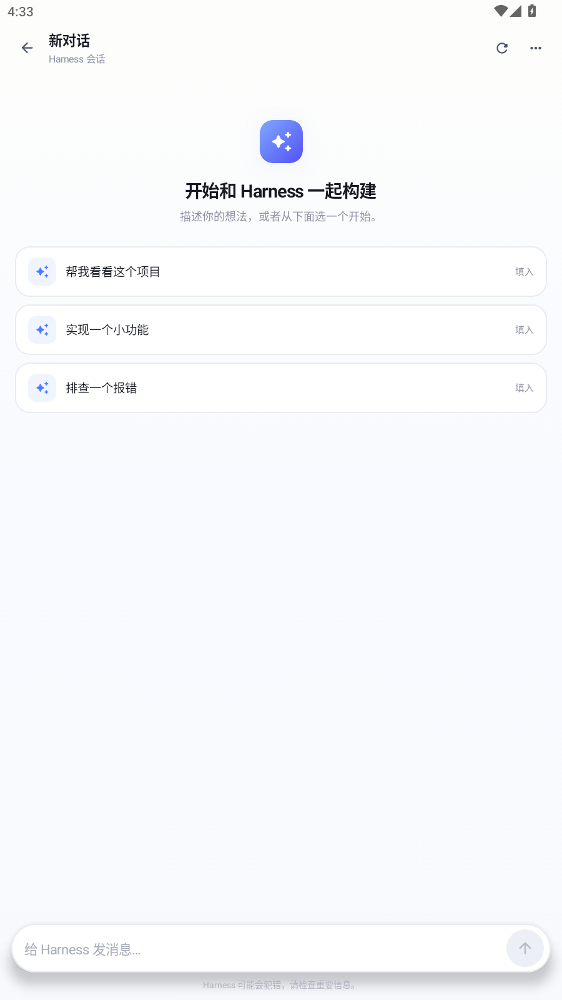
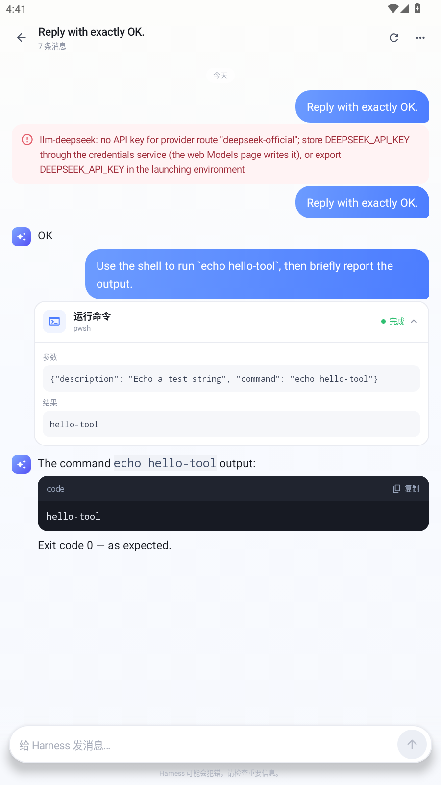

# Harness Pocket

把 DeepSeek Harness 装进口袋。一个原生 Android 客户端，通过 DSH 的 Remote API 连接你电脑上的 `dsh web`，在手机上继续和 coding agent 一起写代码。

界面参考豆包：暖白底色、蓝紫渐变、圆角卡片、蓝色用户气泡、无气泡的助手回复，以及可展开的工具调用卡片。

<p align="center">
  
  
  
  
</p>

## 功能

- **远程连接**：粘贴 `dsh web` 打印的完整访问链接（含 `?token=`），自动拆分服务器地址与令牌。
- **会话列表**：查看最近会话、运行状态、工作目录和相对更新时间。
- **继续对话**：打开历史会话，发送新消息，停止当前任务，重命名或刷新会话。
- **工具调用可视化**：把 `tool/call`、`tool/result` 渲染成可展开卡片，参数和结果都能看。
- **Markdown**：标题、列表、引用、粗体、行内代码、代码块；代码块支持一键复制。
- **自动续期**：API Cookie 过期后，用本地保存的启动令牌自动重新 `/connect`。
- **无遥测**：不接入任何统计 SDK，令牌和会话只保存在本机。

## 安装

### 直接安装 APK

构建产物在：

```text
app/build/outputs/apk/debug/app-debug.apk
```

连接手机或模拟器后：

```bash
adb install -r app/build/outputs/apk/debug/app-debug.apk
```

也可以把 APK 传到手机后直接安装。当前 APK 使用 debug 签名，适合自用和测试；正式分发请配置自己的 release keystore。

### 从源码构建

环境要求：

- JDK 11 或 17
- Android SDK Platform 33、Build-Tools 33.0.2
- 无需预装 Gradle，仓库自带 Gradle Wrapper 7.6.4

```bash
# Linux / macOS
export JAVA_HOME=/path/to/jdk
export ANDROID_HOME=/path/to/android-sdk
./gradlew assembleDebug
```

```powershell
# Windows PowerShell
$env:JAVA_HOME = "C:\Program Files\Java\jdk-11.0.12"
$env:ANDROID_HOME = "C:\path\to\android-sdk"
.\gradlew.bat assembleDebug
```

如果 SDK 不在默认位置，也可以新建 `local.properties`：

```properties
sdk.dir=C\:\\path\\to\\android-sdk
```

`settings.gradle.kts` 优先使用阿里云镜像，再回退到 Google / Maven Central；海外网络可以按需调整仓库顺序。

## 连接你的 Harness

1. 在电脑上启动 `dsh web`（或使用你已经在运行的实例）。启动日志会打印一条带一次性令牌的链接，例如：

   ```text
   http://127.0.0.1:8080/?token=xxxxxxxx
   ```

2. 如果手机和电脑不在同一台机器，需要让 `dsh web` 监听局域网地址，或通过反向代理 / 内网穿透暴露端口。跨机访问时，记得把实际地址加入可信 Host，例如：

   ```bash
   dsh web --host 0.0.0.0 --port 18080 \
     --trusted-host 192.168.1.10:18080
   ```

   反向代理场景请保留原始 Host，并按 DSH 文档配置 `--trusted-host`。

3. 在 App 的连接页粘贴**完整链接**（推荐），或分别填写服务器地址与令牌。App 会请求：

   ```text
   GET {server}/connect?token={token}&interactions=none
   ```

   拿到 `dsh-auth-*` Cookie 后，所有 API 请求都会带上它。

4. 连接成功后即可看到会话列表。点开会话继续聊天，点底部的输入框新建会话。

> 令牌等同于登录凭证。不要把它发到公开群聊、截图或提交到 Git 仓库。

## 项目结构

```text
app/src/main/java/dev/harness/pocket/
├── MainActivity.kt          # 单 Activity + Compose 路由
├── MainViewModel.kt         # 连接、会话、轮询、发送、停止
├── data/
│   ├── HarnessApi.kt        # /connect、/api RPC、Cookie 续期
│   ├── EventParser.kt       # DSH 事件 → UI 模型
│   ├── Models.kt            # Connection / Session / ChatItem
│   ├── ConnectionInput.kt   # 完整链接解析
│   ├── Prefs.kt             # 本地保存连接信息
│   └── Errors.kt
└── ui/
    ├── Theme.kt             # 豆包风配色与排版
    ├── ConnectScreen.kt     # 登录页
    ├── HomeScreen.kt        # 会话列表
    ├── ChatScreen.kt        # 对话页
    ├── Components.kt        # 气泡、工具卡、输入框、设置
    ├── Markdown.kt          # 轻量 Markdown 解析与渲染
    └── Formatters.kt
```

协议细节见 [docs/PROTOCOL.md](docs/PROTOCOL.md)。

## 已知限制

- **轮询而非长连接**：当前通过 `session/list` + `session/page` 刷新，助手文本在消息落盘后出现，不是逐 token 打字机效果。后续会接入 `session/follow` WebSocket。
- **历史窗口**：每次最多取 80 条消息、24 条消息 / 4 个 turn 的窗口；很长的会话可能只显示最近部分。
- **审批交互**：以 `interactions=none` 连接，沙箱内自动放行的工具可以直接执行；需要人工审批的操作目前无法在 App 内点“同意”。请先在 Web 端处理审批，或把相应策略配置为自动允许。
- **附件与模型选择**：暂不支持图片/文件附件，也不支持在 App 内切换模型；使用服务端默认模型。
- **明文 HTTP**：为了连接自建服务，Manifest 开启了 `usesCleartextTraffic`。公网使用请务必套 HTTPS 或 VPN。
- **令牌存储**：保存在应用私有的 `SharedPreferences`，未做额外加密；不要在已 root 的设备上使用敏感环境。

## Roadmap

- [ ] `session/follow` WebSocket，逐字流式输出
- [ ] 审批卡片（approval/asked / approval/decided）
- [ ] 模型与推理强度选择
- [ ] 图片、文件附件
- [ ] 会话搜索、归档、删除
- [ ] 深色模式与平板布局
- [ ] 可配置的 HTTPS / 证书校验

## 安全说明

- App 只与你填写的服务器通信，没有第三方接口、统计或崩溃上报。
- 启动令牌只用于换取 API Cookie；Cookie 与令牌都保存在应用私有目录。
- `/connect` 使用 `interactions=none`，不会在后台替你批准任何操作。
- 这是一个第三方客户端，不是 DeepSeek 官方产品；DSH 升级后协议可能变化。

## License

[MIT](LICENSE)
